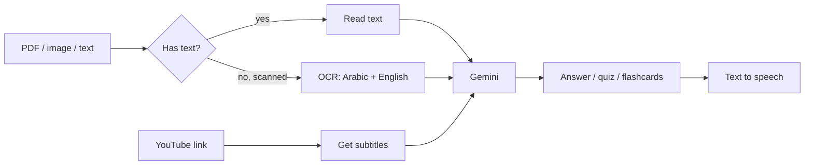

<p align="center">
  
</p>

<p align="center">
  
</p>

<p align="center">
  
  
  
  
</p>

## What is this?

A study helper app built with **Streamlit** and **Google Gemini**.
You upload your study files (PDF, image or text) and the app helps you learn from them.

It also reads **scanned PDFs and images** with OCR, in **Arabic and English**.

## Features

| Tool | What it does |
|------|--------------|
| 📄 **Document Intelligence** | Upload a file and ask questions about it |
| 📝 **Quiz Generator** | Makes a quiz from your file |
| 🎬 **Video Analyzer** | Paste a YouTube link and get a summary of the video |
| 🤖 **AI Learning Assistant** | Ask any study question |
| 🃏 **Flashcard Creator** | Makes flashcards for quick review |
| 🔊 **Voice Assistant** | Reads the answer out loud |
| 🖼️ **Visual Analyzer** | Reads text from images |

## How it works



## How to run

**1. Install the tools**

- [Tesseract OCR](https://github.com/UB-Mannheim/tesseract/wiki). Add the Arabic language pack.
- [Poppler](https://github.com/oschwartz10612/poppler-windows/releases). This is needed to read scanned PDFs.

**2. Install the Python packages**

```bash
pip install -r requirements.txt
```

**3. Add your API key**

Copy `env.template` to a new file called `.env` and add your key:

```
GOOGLE_API_KEY=your-key-here
```

You can get a free key from [Google AI Studio](https://aistudio.google.com/apikey).

> ⚠️ Never upload your `.env` file. It is already in `.gitignore`.

**4. Start the app**

```bash
streamlit run app.py
```

## Built with

- **Streamlit**: the web app
- **Google Gemini**: answers, quizzes, summaries
- **PyPDF2 + pdf2image + Tesseract**: reading PDFs and images
- **youtube-transcript-api**: getting video subtitles
- **gTTS**: text to speech
- **langdetect**: finding the language of the text

<p align="center">
  
</p>
